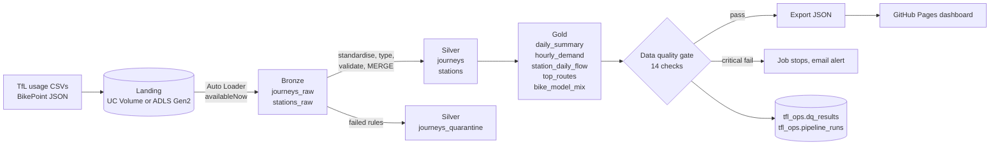

# TfL Bike Hire Lakehouse

**An end-to-end Databricks lakehouse on Transport for London's Santander Cycles journey data.**
Incremental ingestion with Auto Loader, Bronze/Silver/Gold Delta Lake tables, PySpark and Spark SQL
transformations, a 14-check data quality gate, Unity Catalog governance, and a Databricks Workflows
job defined as code. Storage switches from a Unity Catalog Volume to Azure Data Lake Storage Gen2
with one config value.

[](https://github.com/Olayinka08/tfl-bike-lakehouse/actions/workflows/ci.yml)

**Live dashboard:** https://olayinka08.github.io/tfl-bike-lakehouse

---
## Results

Processed **2,068,001** real TfL journeys across **804** docking stations (01 Jun 2026 to DATE_TO). **1,173** invalid records (0.06%) were quarantined with reasons rather than dropped, and **14/14** data quality checks pass on every run. Incremental loading and idempotency verified: a new file added exactly its own rows, and a re-run with no new files changed nothing.

## The business problem

London's cycle hire scheme moves hundreds of thousands of bikes a week. Two operational questions
decide whether a rider finds a bike (or a free dock):

1. **When and where is demand?** Commute peaks, weekend leisure, busiest routes.
2. **Which docks run empty or overflow?** Stations with a persistent net outflow need restocking;
   stations with a net inflow need bikes collected. That is the rebalancing problem.

This project builds the data platform that answers both, reliably and repeatably, from TfL's raw
weekly journey files.

## Architecture



### Screenshots

| Workflows job run | Unity Catalog lineage |
|---|---|
|  |  |

| Data quality results | Incremental runs log |
|---|---|
|  |  |

**Orchestration:** one Databricks Workflows job, seven tasks:
`setup_catalog → bronze_ingest → silver_transform → gold_aggregates → data_quality → (governance, export_dashboard)`

## Tech stack

| Area | Used here |
|---|---|
| Platform | Databricks (serverless compute), Databricks Workflows, Asset Bundles |
| Storage | Delta Lake on a Unity Catalog Volume; Azure Data Lake Storage Gen2 ready (`abfss://`) |
| Processing | PySpark, Spark SQL, Auto Loader (`cloudFiles`), Delta `MERGE`, liquid clustering |
| Governance | Unity Catalog: three-level namespace, comments, tags, grants, automatic lineage |
| Quality | Rule-based validation, quarantine table, reconciliation checks, results stored in Delta |
| Engineering | Python package shared by notebooks and tests, pytest (27 tests), ruff, GitHub Actions CI |
| Presentation | Static dashboard (HTML + Chart.js) on GitHub Pages |

## Design decisions

* **Bronze keeps raw strings.** `cloudFiles.inferColumnTypes = false`, so a malformed file never blocks ingestion. Typing happens in silver where failures can be handled.
* **ANSI-safe parsing.** Databricks serverless runs with ANSI mode on, where a bad cast throws. Silver uses `try_cast` and `try_to_timestamp`, and the test suite runs with ANSI on to match.
* **Quarantine, not delete.** Rows that fail any of 8 rules go to `journeys_quarantine` with a `dq_reason` (for example `end_before_start;duration_over_24h`). Nothing disappears silently.
* **Idempotent by design.** Auto Loader checkpoints mean each file loads once. Silver de-duplicates on `rental_id` and upserts with `MERGE`, so re-running the job or re-uploading a file never double counts.
* **Gold reconciles to silver.** Every gold table's totals are checked back to the silver row count, and station net flow must sum to zero (every departure is someone else's arrival). If a gold bug drops rows, the job fails before the dashboard updates.
* **One codebase, two runtimes.** All logic lives in `src/lakehouse/` as pure DataFrame functions. Notebooks call it on Databricks; pytest calls it locally and in CI.
* **Both TfL file layouts supported.** Pre-2022 files (`Rental Id`, `StartStation Id`) and current files (`Number`, `Start station number`, `Total duration (ms)`) map onto one schema.
* **Storage is a config switch.** `storage_mode = volume` for Databricks Free Edition, `adls` for Azure Data Lake Storage Gen2 through a Unity Catalog external location. No notebook changes.

## Data quality checks

| # | Check | Layer | Severity |
|---|---|---|---|
| 1 | Row count above zero | Silver | Critical |
| 2 | `rental_id` unique | Silver | Critical |
| 3 | No null keys (id, start, end) | Silver | Critical |
| 4 | End time after start time | Silver | Critical |
| 5 | Duration within (0, 24h] | Silver | Critical |
| 6 | Quarantine rate at or below 5% | Silver | Warning |
| 7 | Freshness of latest journey date | Silver | Warning |
| 8 | Daily trips reconcile to silver | Gold | Critical |
| 9 | One row per date in daily summary | Gold | Critical |
| 10 | Hourly trips reconcile to silver | Gold | Critical |
| 11 | Station departures reconcile to silver | Gold | Critical |
| 12 | Station arrivals reconcile to silver | Gold | Critical |
| 13 | Station net flow sums to zero | Gold | Critical |
| 14 | Bike mix trips and shares reconcile | Gold | Critical |

## Repository structure

```
tfl-bike-lakehouse/
├── notebooks/                 Databricks notebooks (source format), run in order by the job
│   ├── 00_setup_catalog.py    schemas, volume, folders, ops tables
│   ├── 01_bronze_ingest.py    Auto Loader ingestion + optional BikePoint stations
│   ├── 02_silver_transform.py standardise, validate, quarantine, MERGE
│   ├── 03_gold_aggregates.py  five business aggregates
│   ├── 04_data_quality.py     14 checks, results to Delta, fail on critical
│   ├── 05_governance.py       comments, tags, grants
│   └── 06_export_dashboard.py gold to dashboard_data.json
├── src/lakehouse/             shared Python package
│   ├── config.py              catalog, schemas, storage mode, paths
│   ├── transforms.py          bronze, silver and gold transformations
│   ├── quality.py             data quality checks
│   └── export.py              dashboard payload
├── tests/                     27 pytest tests (PySpark, ANSI mode)
├── scripts/                   sample data generator, local end-to-end runner
├── docs/                      GitHub Pages dashboard
├── databricks.yml             Asset Bundle: the job as code
└── .github/workflows/ci.yml   lint, test, smoke run on every push
```

## Run it

Full step-by-step instructions, from creating the Databricks account to the Azure move, are in
**[SETUP_GUIDE.md](SETUP_GUIDE.md)**.

Quick local check (Python 3.11, Java 17):

```bash
pip install -r requirements-dev.txt
pytest
python scripts/generate_sample_data.py
python scripts/run_local_pipeline.py
```

## What I would add next

* Delta Live Tables (Lakeflow Declarative Pipelines) version with expectations, to compare against the hand-built quality gate.
* Change Data Feed on silver so gold refreshes only changed dates.
* Weather join (Open-Meteo) to model demand against rain and temperature.
* Power BI or Databricks AI/BI dashboard on the gold schema via a SQL warehouse.

## Data and licence

Journey and station data: Transport for London open data. Powered by TfL Open Data.
Contains OS data © Crown copyright and database rights. Code: MIT.

Built by **Olayinka Bello** · [LinkedIn](https://www.linkedin.com/in/olayinka-bello-mba-04960b12a) · [GitHub](https://github.com/Olayinka08)
