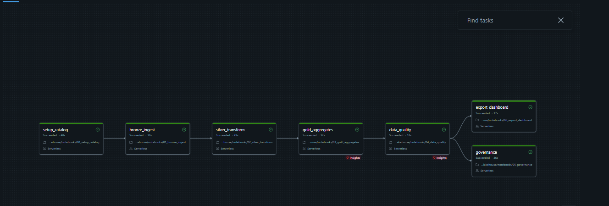
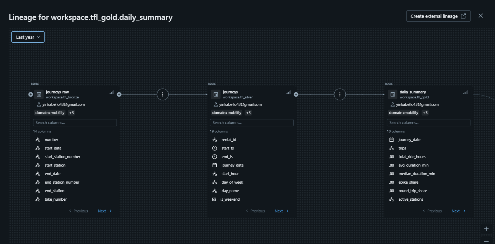
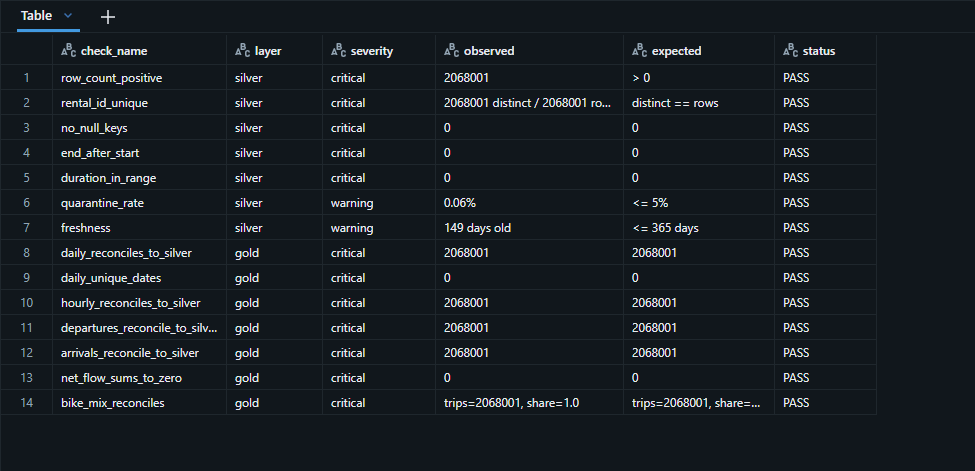
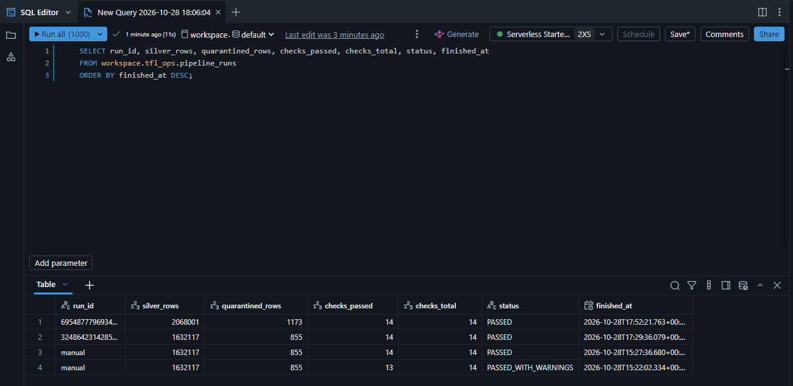

# Setup Guide: TfL Bike Hire Lakehouse

Every step from an empty laptop to a live, CV-ready project. Do the parts in order.
Tick each box as you go.

> Databricks menus change from time to time. If a button label differs slightly from this guide,
> look for the closest match in the same area of the screen.

**What you will end up with**

* A public GitHub repo with green CI on every push
* A Databricks Free Edition workspace running a 7-task orchestrated job on real TfL data
* Unity Catalog tables with comments, tags, grants and lineage
* A live dashboard on GitHub Pages
* Screenshots and a CV line

**Time:** about 3 to 4 hours spread over Parts 1 to 16. Part 17 (Azure) is optional and later.

**Cost:** £0 for Parts 1 to 16. Part 17 uses Azure free credit; delete resources afterwards.

---

## Part 1: Put the project on your computer

- [ ] 1.1 Download `tfl-bike-lakehouse.zip` from this chat.
- [ ] 1.2 Create a folder for your projects if you do not have one, for example `Documents/Projects`.
- [ ] 1.3 Unzip so you have `Documents/Projects/tfl-bike-lakehouse/` containing `README.md`, `notebooks/`, `src/` and so on.
- [ ] 1.4 Open a terminal in that folder:
  * **Windows:** open the folder in File Explorer, right-click empty space, choose **Open in Terminal** (or open **Git Bash** there).
  * **Mac:** open Terminal, type `cd ` (with a space), drag the folder into the window, press Enter.
- [ ] 1.5 Check you are in the right place:
  ```bash
  ls
  ```
  You should see `README.md  SETUP_GUIDE.md  databricks.yml  docs  notebooks  scripts  src  tests`.

## Part 2: Local setup and tests (recommended)

This proves the code works before you touch Databricks. If local Spark gives you trouble on Windows,
skip to Part 3: GitHub Actions runs exactly the same tests in the cloud.

- [ ] 2.1 **Python 3.11.** Check with `python --version` (Mac: `python3 --version`). If missing, install 3.11 from python.org. On Windows tick **Add Python to PATH** during install.
- [ ] 2.2 **Java 17** (Spark needs it). Check with `java -version`. If missing, install **Temurin 17 (LTS)** from adoptium.net, then close and reopen the terminal.
- [ ] 2.3 Create a virtual environment:
  ```bash
  python -m venv .venv
  ```
- [ ] 2.4 Activate it:
  * Windows PowerShell: `.venv\Scripts\Activate.ps1`
  * Windows Git Bash: `source .venv/Scripts/activate`
  * Mac: `source .venv/bin/activate`

  Your prompt now starts with `(.venv)`.
- [ ] 2.5 Install dependencies:
  ```bash
  pip install -r requirements-dev.txt
  ```
- [ ] 2.6 Run the tests:
  ```bash
  pytest
  ```
  Expected: `27 passed`.
- [ ] 2.7 Run the linter:
  ```bash
  ruff check src tests scripts
  ```
  Expected: `All checks passed!`
- [ ] 2.8 Generate synthetic data and run the whole pipeline locally:
  ```bash
  python scripts/generate_sample_data.py
  python scripts/run_local_pipeline.py
  ```
  Expected output includes `silver rows`, `quarantined rows: 99` and `quality: 14/14 passed`.
- [ ] 2.9 View the dashboard locally:
  ```bash
  cd docs
  python -m http.server 8000
  ```
  Open http://localhost:8000 in your browser. You should see the dashboard with a "synthetic sample" banner. Press `Ctrl+C` in the terminal to stop, then `cd ..` to go back.

## Part 3: Create the GitHub repo and push

- [ ] 3.1 Go to github.com, sign in as **Olayinka08**, click **+** (top right) → **New repository**.
- [ ] 3.2 Fill in:
  * Repository name: `tfl-bike-lakehouse`
  * Description: `Databricks medallion lakehouse on TfL cycle hire data: Auto Loader, Delta Lake, Unity Catalog, Workflows, data quality gate, CI`
  * **Public**
  * Do **not** tick "Add a README", ".gitignore" or "licence" (the project already has them).
- [ ] 3.3 Click **Create repository**.
- [ ] 3.4 Back in the terminal, in the project folder:
  ```bash
  git init
  git add .
  git commit -m "Initial commit: TfL bike hire lakehouse on Databricks"
  git branch -M main
  git remote add origin https://github.com/Olayinka08/tfl-bike-lakehouse.git
  git push -u origin main
  ```
  If asked to sign in, use your browser sign-in or a personal access token, as you did for the other repos.
- [ ] 3.5 Check nothing large was pushed: on the repo page there should be **no** `data/` folder (it is ignored on purpose).
- [ ] 3.6 Click the **Actions** tab. A run called **CI** starts automatically. Wait about 3 minutes for a green tick.
  * If it is red, click into it, open the failed step and send me the error text.

## Part 4: Turn on GitHub Pages

- [ ] 4.1 Repo → **Settings** → **Pages** (left menu).
- [ ] 4.2 Under **Build and deployment**: Source = **Deploy from a branch**, Branch = **main**, Folder = **/docs**. Click **Save**.
- [ ] 4.3 Wait 1 to 2 minutes, refresh. The page shows: *Your site is live at https://olayinka08.github.io/tfl-bike-lakehouse/*
- [ ] 4.4 Open it. You will see the synthetic sample for now. Part 14 replaces it with real TfL results.

## Part 5: Create your Databricks Free Edition workspace

- [ ] 5.1 Go to **databricks.com/learn/free-edition** and click **Sign up** (or search "Databricks Free Edition").
- [ ] 5.2 Sign up with your email or Google account. Free Edition does not need a card.
- [ ] 5.3 Once the workspace opens, note its URL from the browser address bar, for example `https://dbc-a1b2c3d4-e5f6.cloud.databricks.com`. You need it in Part 11.
- [ ] 5.4 Look at the left sidebar. You should see **Workspace**, **Catalog**, **Jobs & Pipelines**, **SQL Editor** and **Compute**.
- [ ] 5.5 Click **Catalog**. You should see a catalog called **workspace**. That is where everything will be built.

## Part 6: Bring the repo into Databricks (Git folder)

- [ ] 6.1 Link GitHub so you can pull changes: click your profile icon (top right) → **Settings** → **Linked accounts** → **Add Git credential** → provider **GitHub** → **Link Git account** and authorise.
- [ ] 6.2 Left sidebar → **Workspace** → **Home** (your user folder).
- [ ] 6.3 Click **Create** → **Git folder**.
- [ ] 6.4 Git repository URL: `https://github.com/Olayinka08/tfl-bike-lakehouse.git`. Provider: GitHub. Folder name: `tfl-bike-lakehouse`. Click **Create Git folder**.
- [ ] 6.5 Open the new folder. You should see `notebooks`, `src`, `tests`, `docs` and the other files.
- [ ] 6.6 Note the notebook paths. They look like:
  `/Workspace/Users/<your-email>/tfl-bike-lakehouse/notebooks/00_setup_catalog`

## Part 7: Run the setup notebook

- [ ] 7.1 Open `notebooks/00_setup_catalog`.
- [ ] 7.2 Top right, click the compute selector and choose **Serverless** (Free Edition only has serverless). Wait for it to show **Connected**.
- [ ] 7.3 Widgets appear at the top. Leave defaults: catalog `workspace`, storage mode `volume`, ADLS fields blank.
- [ ] 7.4 Click **Run all**.
- [ ] 7.5 Expected output: four `schema ready` lines, five `folder ready` lines, `Setup complete.`
- [ ] 7.6 Check in **Catalog** → **workspace**: you now have schemas `tfl_bronze`, `tfl_silver`, `tfl_gold`, `tfl_ops`. Inside `tfl_bronze` there is a volume called `landing`.

## Part 8: Download real TfL data

- [ ] 8.1 Open **https://cycling.data.tfl.gov.uk/** in your browser.
- [ ] 8.2 Open the **usage-stats** folder. Files are weekly extracts with names like `<number>JourneyDataExtract<start>-<end>.csv`.
- [ ] 8.3 Scroll to the most recent files and download **4 consecutive weeks** (about a month). Keep **one more** week aside for Part 12 (the incremental test). So 5 files in total.
  * Use recent files only. They all share the current layout (`Number, Start date, Start station number, ...`). Mixing very old and new files works but forces a schema change on the stream.
- [ ] 8.4 Open one CSV in a text editor (not Excel, the files are big) and check the first line reads like:
  `Number,Start date,Start station number,Start station,End date,End station number,End station,Bike number,Bike model,Total duration,Total duration (ms)`
- [ ] 8.5 (Optional, recommended) Station locations: open **https://api.tfl.gov.uk/BikePoint** in your browser. It returns JSON for every docking station. Save the page as `stations.json` (Ctrl+S or Cmd+S, format "All files" or "Raw data").

## Part 9: Upload the data to the landing volume

- [ ] 9.1 **Catalog** → **workspace** → **tfl_bronze** → **Volumes** → **landing**.
- [ ] 9.2 Open folder **raw** → **journeys**.
- [ ] 9.3 Click **Upload to this volume** and select the **first 4** weekly CSVs (not the 5th). Wait until every upload finishes.
- [ ] 9.4 (Optional) Go back to **raw** → **stations** and upload `stations.json`.
- [ ] 9.5 Confirm the files are listed with their sizes.

## Part 10: Run the pipeline by hand once

Open each notebook, make sure compute is **Serverless**, then **Run all**. Wait for each to finish before the next.

- [ ] 10.1 `01_bronze_ingest`: lists your 4 files, runs Auto Loader, shows rows per source file. Optional stations step loads if you uploaded `stations.json`.
- [ ] 10.2 `02_silver_transform`: prints MERGE metrics (all rows inserted on the first run), shows the quarantine reasons table and 10 sample silver rows.
- [ ] 10.3 `03_gold_aggregates`: prints row counts for the 5 gold tables and previews daily summary and top routes.
- [ ] 10.4 `04_data_quality`: shows a table of 14 checks and ends with `14/14 checks passed` (or `PASSED_WITH_WARNINGS`; see note below).
  * If **freshness** warns, the TfL files are older than 120 days. That is a warning only. You can raise the `freshness_days` widget.
- [ ] 10.5 `05_governance`: prints `OK` or `SKIP` lines. A few `SKIP` lines are normal on Free Edition (for example grants to a group that does not exist). Comments and tags should be `OK`.
- [ ] 10.6 `06_export_dashboard`: prints `written: /Volumes/workspace/tfl_bronze/landing/exports/dashboard/dashboard_data.json` and the headline numbers.
- [ ] 10.7 Write down the headline numbers (total journeys, date range, quarantined rows). You will use them on your CV and LinkedIn.

## Part 11: Orchestrate with a Databricks Workflows job (UI)

- [ ] 11.1 Left sidebar → **Jobs & Pipelines** → **Create** → **Job**.
- [ ] 11.2 Rename the job (top left, click "New Job ...") to `tfl-lakehouse-pipeline`.
- [ ] 11.3 **Task 1:**
  * Task name: `setup_catalog`
  * Type: **Notebook**
  * Source: **Workspace**
  * Path: browse to `tfl-bike-lakehouse/notebooks/00_setup_catalog`
  * Compute: **Serverless**
  * Click **Create task**.
- [ ] 11.4 Click **+ Add task** → **Notebook** for each of the following. Set **Depends on** exactly as shown:

  | Task name | Notebook | Depends on |
  |---|---|---|
  | `bronze_ingest` | `01_bronze_ingest` | `setup_catalog` |
  | `silver_transform` | `02_silver_transform` | `bronze_ingest` |
  | `gold_aggregates` | `03_gold_aggregates` | `silver_transform` |
  | `data_quality` | `04_data_quality` | `gold_aggregates` |
  | `governance` | `05_governance` | `data_quality` |
  | `export_dashboard` | `06_export_dashboard` | `data_quality` |

- [ ] 11.5 On `silver_transform`, open **Retries** and set **1** retry.
- [ ] 11.6 Job-level parameters: in the right panel find **Job parameters** → **Edit parameters** and add:

  | Key | Value |
  |---|---|
  | `catalog` | `workspace` |
  | `storage_mode` | `volume` |
  | `run_id` | `{{job.run_id}}` |

  Job parameters are passed to every notebook's widgets automatically.
- [ ] 11.7 Right panel → **Job notifications** → **Add notification** → your email → tick **Failure**.
- [ ] 11.8 Right panel → **Schedules & Triggers** → **Add trigger** → **Scheduled** → weekly, Monday, 06:00, timezone **(UTC+00:00) Europe/London**. Set it to **Paused** for now (you can unpause later). Save.
- [ ] 11.9 Click **Run now** (top right).
- [ ] 11.10 Open the run. You should see the task graph go green task by task: setup, bronze, silver, gold, quality, then governance and export in parallel.
- [ ] 11.11 **Screenshot 1:** the completed run graph (all green). Save as `job_run.png`.
- [ ] 11.12 Prove the gate works (optional but good for interviews): in `04_data_quality` you can see `assert_no_critical_failures`. If a critical check ever fails, the export task shows as **Upstream failed** and never runs.

### Part 11B (optional): deploy the job as code with Asset Bundles

Only do this if you want to show "infrastructure as code". Part 11 already gives you a working job.

- [ ] 11B.1 Install the Databricks CLI: follow "Install the Databricks CLI" in the Databricks docs (Windows: `winget install Databricks.DatabricksCLI`; Mac: `brew tap databricks/tap && brew install databricks`).
- [ ] 11B.2 In `databricks.yml`, replace `https://REPLACE-WITH-YOUR-WORKSPACE.cloud.databricks.com` with your workspace URL from step 5.3. Commit and push.
- [ ] 11B.3 Log in: `databricks auth login --host <your-workspace-url>` and complete the browser sign-in.
- [ ] 11B.4 Validate: `databricks bundle validate` (expect `Validation OK!`).
- [ ] 11B.5 Deploy: `databricks bundle deploy`. A job called `[dev <you>] tfl-lakehouse-pipeline` appears under Jobs & Pipelines.
- [ ] 11B.6 Run: `databricks bundle run tfl_lakehouse_pipeline`.
- [ ] 11B.7 You now have two jobs. Delete one (keep whichever you prefer) so the schedule does not run twice.

## Part 12: Prove incremental loading and idempotency

This is the part interviewers ask about.

- [ ] 12.1 Upload the **5th** weekly CSV to `landing/raw/journeys`.
- [ ] 12.2 Jobs & Pipelines → `tfl-lakehouse-pipeline` → **Run now**.
- [ ] 12.3 Open the `bronze_ingest` task output: the rows-per-file table now shows 5 files, but this run only ingested the new one (Auto Loader checkpoint).
- [ ] 12.4 Open `silver_transform` output: MERGE metrics show inserts for the new week only.
- [ ] 12.5 Run the job **again** without uploading anything. Bronze ingests nothing new, MERGE inserts 0, gold totals do not change. That is idempotency.
- [ ] 12.6 Open **SQL Editor** and run:
  ```sql
  SELECT run_id, silver_rows, quarantined_rows, checks_passed, checks_total, status, finished_at
  FROM workspace.tfl_ops.pipeline_runs
  ORDER BY finished_at DESC;
  ```
  You should see each run with silver row counts going up after 12.2 and staying flat after 12.5.
- [ ] 12.7 **Screenshot 2:** that query result. Save as `pipeline_runs.png`.

## Part 13: Explore governance and lineage

- [ ] 13.1 **Catalog** → workspace → tfl_gold → `daily_summary`. Check the **Overview** tab shows the table comment and the tags (`layer`, `domain`, `source`, `pii`).
- [ ] 13.2 Click the **Lineage** tab → **See lineage graph**. Expand upstream until you see `tfl_bronze.journeys_raw → tfl_silver.journeys → tfl_gold.daily_summary`.
- [ ] 13.3 **Screenshot 3:** the lineage graph. Save as `lineage.png`.
- [ ] 13.4 Open `tfl_silver.journeys` → **Columns**: column comments are visible on `rental_id`, `duration_s`, `day_of_week` and others.
- [ ] 13.5 Run in SQL Editor and look at the reasons rows were rejected:
  ```sql
  SELECT dq_reason, COUNT(*) AS rows
  FROM workspace.tfl_silver.journeys_quarantine
  GROUP BY dq_reason ORDER BY rows DESC;
  ```
- [ ] 13.6 Run a real analysis query (good for an interview demo):
  ```sql
  -- stations that most need restocking over the period
  SELECT station_name, SUM(departures) AS out_trips, SUM(arrivals) AS in_trips, SUM(net_flow) AS net
  FROM workspace.tfl_gold.station_daily_flow
  GROUP BY station_name ORDER BY net ASC LIMIT 10;
  ```
- [ ] 13.7 **Screenshot 4:** the data quality results:
  ```sql
  SELECT check_name, layer, severity, observed, expected, status
  FROM workspace.tfl_ops.dq_results
  WHERE run_id = (SELECT run_id FROM workspace.tfl_ops.dq_results ORDER BY checked_at DESC LIMIT 1);
  ```
  Save as `dq_results.png`.

## Part 14: Publish real results to the live dashboard

- [ ] 14.1 **Catalog** → workspace → tfl_bronze → Volumes → landing → **exports** → **dashboard**.
- [ ] 14.2 Click the three dots next to `dashboard_data.json` → **Download**.
- [ ] 14.3 On your computer, replace `tfl-bike-lakehouse/docs/data/dashboard_data.json` with the downloaded file (same name, same place).
- [ ] 14.4 Create a folder `docs/img/` and copy in your 4 screenshots: `job_run.png`, `pipeline_runs.png`, `lineage.png`, `dq_results.png`.
- [ ] 14.5 Add the screenshots to the README. Open `README.md` and paste this block directly under the "Architecture" section:
  ```markdown
  ### Screenshots

  | Workflows job run | Unity Catalog lineage |
  |---|---|
  |  |  |

  | Data quality results | Incremental runs log |
  |---|---|
  |  |  |
  ```
- [ ] 14.6 Add a "Results" line under "The business problem" in the README using your numbers from 10.7 and 12.6, for example:
  `Processed X journeys across Y stations (date to date); Z rows quarantined by validation; 14/14 quality checks passing.`
- [ ] 14.7 Commit and push:
  ```bash
  git add docs README.md
  git commit -m "Publish real TfL results, screenshots and results summary"
  git push
  ```
- [ ] 14.8 Wait 1 to 2 minutes, refresh https://olayinka08.github.io/tfl-bike-lakehouse. The "synthetic sample" banner is gone and the numbers are real.
- [ ] 14.9 In Databricks, open your Git folder → click the branch name → **Pull** so the workspace copy matches GitHub.

## Part 15: Polish the GitHub repo

- [ ] 15.1 Repo main page → gear icon next to **About**:
  * Description: (same as 3.2)
  * Website: `https://olayinka08.github.io/tfl-bike-lakehouse`
  * Topics: `databricks`, `pyspark`, `delta-lake`, `unity-catalog`, `data-engineering`, `medallion-architecture`, `azure`, `etl`, `data-quality`, `tfl`
  * Save.
- [ ] 15.2 Your GitHub profile → **Customize your pins** → pin `tfl-bike-lakehouse` alongside your other projects.
- [ ] 15.3 Confirm the CI badge at the top of the README shows **passing**.

## Part 16: Add it to your portfolio, CV and LinkedIn

- [ ] 16.1 **Portfolio site:** add a ledger row: Problem "London cycle hire rebalancing and demand", Method "Databricks medallion lakehouse, Auto Loader, Delta MERGE, 14-check quality gate", Tools "Databricks, PySpark, Spark SQL, Delta Lake, Unity Catalog, Workflows", Result "your journeys figure, 14/14 checks, live dashboard". Link both the repo and the Pages URL.
- [ ] 16.2 **CV (data engineering track only):** add to the Portfolio line:
  `TfL Bike Lakehouse: Databricks medallion platform (Auto Loader, Delta Lake MERGE, Unity Catalog, Workflows), 14-check data quality gate, CI; github.com/Olayinka08/tfl-bike-lakehouse`
- [ ] 16.3 **Interview talking points** (practise saying these):
  * Why bronze stays as strings, and how ANSI mode shaped the silver parsing.
  * How Auto Loader checkpoints plus `MERGE` on `rental_id` make re-runs safe.
  * Why gold reconciles back to silver, and why net flow must sum to zero.
  * How one config value moves storage to ADLS Gen2 through a Unity Catalog external location.
- [ ] 16.4 **LinkedIn post (optional):** one short post with the dashboard link and one screenshot (lineage graph works well).
- [ ] 16.5 Tell me when this is done and I will update the master CV and the portfolio list.

---

## Part 17 (optional, later): Run it on Azure with ADLS Gen2

Do this when you want "Azure Databricks" to be literally true on your CV. It uses paid Azure services
covered by the Azure free credit. **Delete the resource group at the end** to avoid charges.

- [ ] 17.1 Create an Azure account at azure.microsoft.com/free (card needed for identity; free credit applies).
- [ ] 17.2 Azure portal → **Resource groups** → **Create**: name `rg-tfl-lakehouse`, region **UK South**.
- [ ] 17.3 **Storage accounts** → **Create**: resource group `rg-tfl-lakehouse`, name e.g. `tfllakehouse<yourinitials>` (lowercase, unique), region UK South, performance Standard, redundancy LRS. On the **Advanced** tab tick **Enable hierarchical namespace** (this makes it ADLS Gen2). Create.
- [ ] 17.4 In the storage account → **Containers** → **+ Container**: name `landing`.
- [ ] 17.5 **Azure Databricks** → **Create**: resource group `rg-tfl-lakehouse`, workspace name `dbw-tfl-lakehouse`, region UK South, pricing tier **Premium** (needed for Unity Catalog). Create, then **Launch Workspace**.
- [ ] 17.6 Search for **Access Connector for Azure Databricks** → **Create**: name `ac-tfl-lakehouse`, same resource group and region. After creation, copy its **Resource ID**.
- [ ] 17.7 Storage account → **Access control (IAM)** → **Add role assignment** → role **Storage Blob Data Contributor** → assign to **Managed identity** → select `ac-tfl-lakehouse`. Save.
- [ ] 17.8 In the Azure Databricks workspace → **Catalog** → **External data** → **Credentials** → **Create credential**: type Azure Managed Identity, name `tfl_storage_cred`, paste the Access Connector Resource ID.
- [ ] 17.9 **External locations** → **Create external location**: name `tfl_landing`, URL `abfss://landing@<storageaccount>.dfs.core.windows.net/`, credential `tfl_storage_cred`. Click **Test connection**: all checks green.
- [ ] 17.10 Create folders and upload data: in the storage account → Containers → `landing` → create `raw/journeys` and `raw/stations`, upload the CSVs and `stations.json` there.
- [ ] 17.11 Add the Git folder in this workspace exactly as in Part 6.
- [ ] 17.12 Run `00_setup_catalog` with widgets: storage mode `adls`, adls_account `<storageaccount>`, adls_container `landing`. (Catalog can stay as the workspace default catalog, or create your own.)
- [ ] 17.13 Create the job as in Part 11 and add two more job parameters: `adls_account` = `<storageaccount>`, `adls_container` = `landing`; set `storage_mode` = `adls`. Run it.
- [ ] 17.14 Screenshot the run and the external location page for the README ("Also deployed on Azure Databricks with ADLS Gen2").
- [ ] 17.15 **Clean up:** Azure portal → Resource groups → `rg-tfl-lakehouse` → **Delete resource group**. Also delete any managed resource group Databricks created (named like `databricks-rg-dbw-tfl-lakehouse-...`) if it remains.

---

## Troubleshooting

| Symptom | Cause | Fix |
|---|---|---|
| `ModuleNotFoundError: lakehouse` in a notebook | Notebook not opened from the Git folder | Open notebooks from `Workspace/Users/<you>/tfl-bike-lakehouse/notebooks`, not a copy elsewhere |
| `No CSV files in /Volumes/...` | Files uploaded to the wrong folder | Upload to `landing/raw/journeys`, not `landing` itself |
| Bronze fails with "schema changed" / `UnknownFieldException` | A file with a different layout arrived | Expected with Auto Loader schema evolution. Re-run the job; the retry picks up the new columns |
| `quarantine_rate` warning | More than 5% of rows failed validation | Check reasons with the query in 13.5; usually very old files or a corrupted download |
| `freshness` warning | TfL files older than the threshold | Warning only. Raise `freshness_days` or download newer files |
| Governance prints `SKIP` for grants | Group does not exist in Free Edition | Normal. Comments and tags are what matter here |
| CI red on GitHub | Usually a dependency download hiccup | Click **Re-run jobs**. If it fails again, send me the log |
| Pages shows old numbers | Browser cache or Pages still building | Wait 2 minutes, hard refresh (Ctrl+Shift+R / Cmd+Shift+R) |
| Want to start completely fresh | Old checkpoints remember loaded files | In SQL Editor: `DROP SCHEMA workspace.tfl_bronze CASCADE` (and the other three), then re-run Part 7 onwards |
